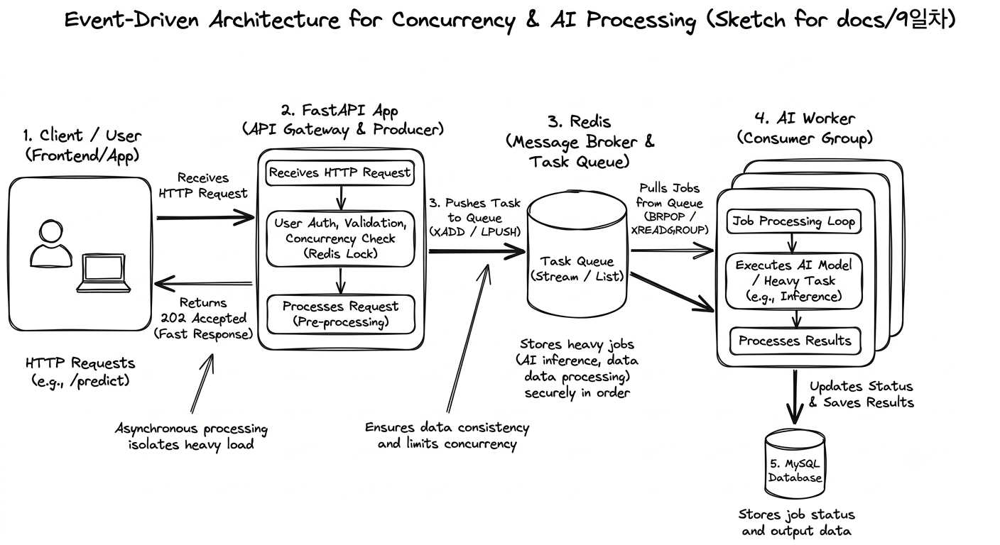

# 9일차: FastAPI와 Redis를 이용한 Event-Driven Architecture 설계

## 1. 개요
- **목적**: 동시성 이슈(재고 소진, 중복 요청 등)를 방지하고, 무거운 AI 연산 작업을 비동기적으로 처리하기 위해 **FastAPI와 Redis 기반의 Event-Driven Architecture(EDA)**를 설계.
- **핵심 목표**: 
  - FastAPI 웹 서버와 AI Worker의 역할을 명확히 분리하여 API 응답 지연 방지
  - Redis를 활용한 안정적인 작업 대기열(Task Queue) 관리

---

## 2. 시스템 아키텍처 설계도 (Excalidraw)
> 동시성 문제 해결 및 비동기 작업 처리를 위한 EDA 구조도

  

---

## 3. 주요 구성 요소 및 역할 분리

### ① FastAPI (API Producer)
- **역할**: 클라이언트의 HTTP 요청을 접수하고, 빠른 응답(Non-blocking)을 반환.
- **동시성 제어**: Redis Distributed Lock을 활용해 임계 구역(Critical Section) 접근 제어.
- **이벤트 발행**: 검증된 작업 요청을 Redis Task Queue에 적재(`Producer`).

### ② Redis (Task Queue & Message Broker)
- **역할**: FastAPI와 AI Worker 간의 버퍼 역할 수행.
- **대기열 관리**: Redis Streams 또는 List 구조를 사용하여 작업 유실을 방지하고 순서 보장.

### ③ AI Worker (Consumer)
- **역할**: Redis 대기열을 모니터링하다가 작업이 들어오면 독립적으로 가져와 처리(`Consumer`).
- **비동기 처리**: 무거운 AI 모델 추론 및 데이터베이스(MySQL) 상태 업데이트 수행.

---

## 4. 기대 효과
1. **성능 향상**: 무거운 AI 연산이 FastAPI 메인 스레드를 블로킹하지 않아 높은 처리량(Throughput) 확보.
2. **안정성**: Redis 대기열을 통한 부하 분산 및 트래픽 폭주 시 시스템 다운 방지.
3. **확장성**: 트래픽 증가에 따라 AI Worker 인스턴스만 유연하게 수평 확장(Scale-out) 가능.